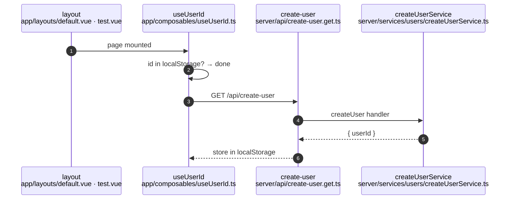
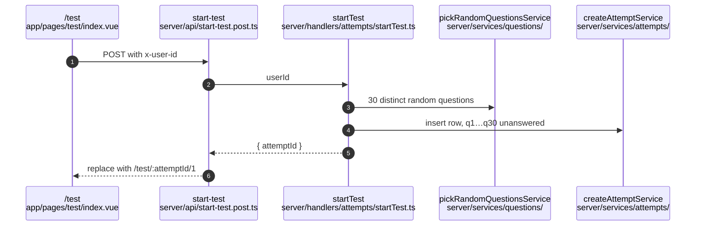
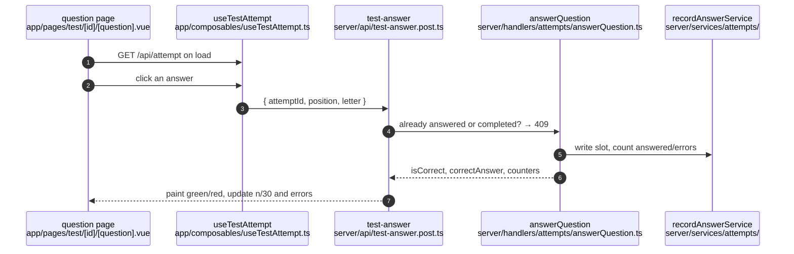
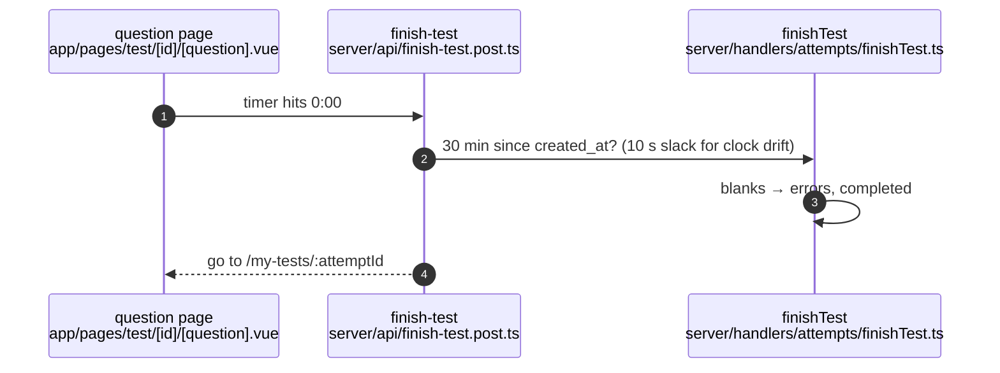
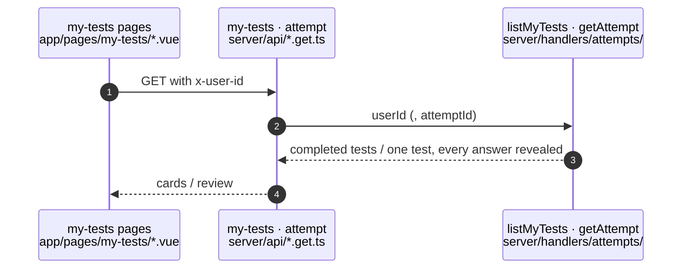

# Practice Tests — Flow

> **Execution reference.** The order a practice session happens in, and why that order. For what it
> is made of, see `practice-tests.ref.md`.

Identify the browser → start a test → answer → time up → review.

---

## Identify the browser

This runs on every mount but creates a user only once. Concurrent callers share one request, so a
page that also needs the id never creates a second user.

---

## Start a test

The row exists before the first question shows, so its `created_at` is the start of the clock. A
refresh or a different device sees the same time left. If the server answers 401 (it forgot the
user), the page gets a fresh id and starts once more.

---

## Answer

The page loads the test fresh on every question, so counters and earlier picks always come from
the row. Answering the 30th question completes the test in the same write. Then the right button
becomes "See result".

---

## Time up

The server checks the time itself, so a test can't be closed early. A test left open past its time
stays incomplete until reopened from "Started tests". The page then sees 0:00 and closes it.

---

## Review

Review uses the same `GET /api/attempt` as the test page. Once a test is completed it returns every
right answer.
